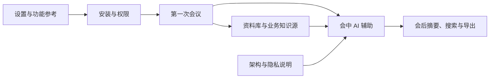

# CueUp 文档目录

CueUp 是本地优先的桌面会议助手：它将音频转写、会议上下文、知识检索和 AI 辅助组合在一起，但每项能力都有独立的权限、模型或服务前提。本目录按读者正在解决的问题组织文档。

当前使用文档按 **2.7.23** 核对日期为 **2026-10-31**。历史计划和 QA 记录保留各自的版本与当时结论，不表示所有待验收项已在当前版本执行。

## 从这里开始

| 你想做什么 | 阅读文档 | 文档类型 |
| --- | --- | --- |
| 安装后完成第一场会议 | [快速入门](QUICKSTART.md) | 教程 |
| 选择模式、会前准备、会中提问、使用卡片或会后处理 | [如何使用会议辅助](HOWTO_MEETING_ASSISTANCE.md) | 操作指南 |
| 上传资料、连接业务系统、维护个人档案或公司调研 | [如何使用知识源与档案智能](HOWTO_KNOWLEDGE_AND_PROFILE.md) | 操作指南 |
| 查找当前功能、设置项、模型、权限和限制 | [功能与设置参考](REFERENCE.md) | 参考 |
| 理解多窗口、转写、检索、隐私范围和数据保存方式 | [架构与隐私说明](ARCHITECTURE.md) | 原理说明 |

## 近期版本与阅读入口

| 版本 | 相关功能变化 | 当前说明 / 证据 |
| --- | --- | --- |
| 2.7.18–2.7.19 | 初始设置五步流程、稍后继续、启动真实会议、欢迎页退出修复 | [快速入门](QUICKSTART.md)；[2.7.19 发布](testing/2.7.19-build-release.md) |
| 2.7.20 | QCLOUD 独立开户指引、音频后端权限检查、首次设置亮暗状态样式 | [功能参考](REFERENCE.md)；[2.7.20 发布](testing/2.7.20-build-release.md) |
| 2.7.21 | QCLOUD 共享 Key、检查提示时效、初始设置与设置项一致性 | [功能参考](REFERENCE.md)；[2.7.21 发布](testing/2.7.21-build-release.md) |
| 2.7.23 | 软件内帮助同步五步初始设置与配置边界，QCLOUD 回归检查实际显示行为 | [设置参考](REFERENCE.md)；[2.7.23 发布](testing/2.7.23-build-release.md) |
| 2.7.22 | 首次设置不再根据屏幕权限推断系统音频受限或已授权 | [权限与配置原理](ARCHITECTURE.md)；[2.7.22 发布](testing/2.7.22-build-release.md) |

“初始设置”用于应用配置，“开始准备”用于单场会议的背景和资料。两者的步骤与成功条件不同，操作见[会议辅助](HOWTO_MEETING_ASSISTANCE.md)。

## 开发与验证

- [贡献指南](../CONTRIBUTING.md)：开发环境、质量检查及文档验证要求。
- [发布流程与更新方式](RELEASE.md)：三平台远程构建、草稿/附件核对、正式发布和当前 latest 通道。
- [通用状态颜色](design/semantic-status-colors.md)：状态文字、背景、边框与应用亮暗主题约定。
- [系统音频权限回归](testing/system-audio-permissions.md)：专用测试命令、必须保留的行为与真机验收边界。
- [2.7.21 本机安装验收](qa/2026-10-30-2.7.21-device-acceptance.md)：Apple Silicon 安装结果、人工接管后的未执行项，以及权限误判诊断与 2.7.22 发布跟进。
- [历史 WhisperLive 说明](LOCAL_STT_CUEUP_SETUP.md)：归档路径，当前语音设置应使用快速入门与参考文档。

## 文档边界

- 本文档描述当前桌面版已实现的用户功能，不承诺第三方 AI、语音服务或业务系统一定可用。
- 需要云端服务的能力会受到账号、网络、余额、限流和数据范围授权影响。
- “建议”“摘要”“卡片”和“检索命中”都应由用户结合原始会议与资料判断；CueUp 不会替你做写入、审批或业务承诺。

## 图示说明

文档中的 Mermaid 图是与代码一起保存的可版本管理流程图。它们用于说明数据流和功能关系，不替代实际界面；界面名称可能随版本迭代而调整。
