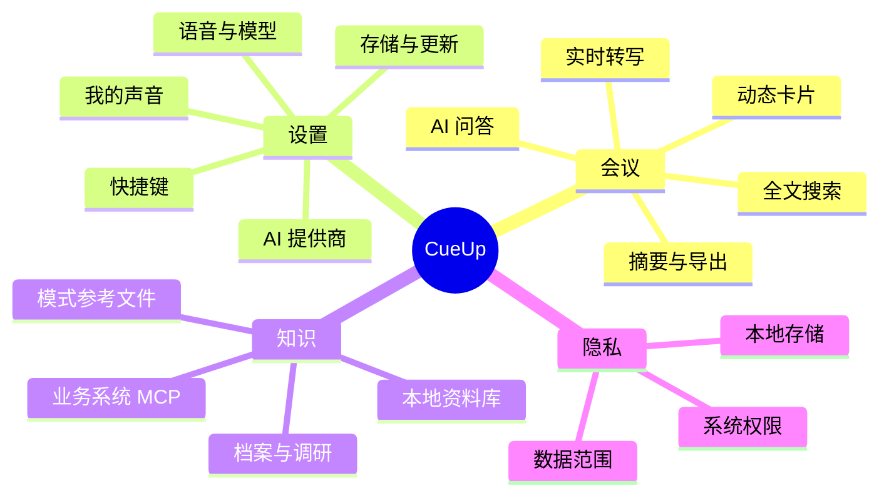

# CueUp 功能与设置参考

本参考面向需要确认“某项功能是否存在、在哪里设置、依赖什么条件”的使用者。实际可用能力还受平台、权限、已配置提供商和数据范围影响。

适用版本：2.7.22，核对日期：2026-10-31。以下为使用界面参考，不是全部 IPC 接口清单。

## 功能地图

## 会议功能

| 功能 | 作用 | 主要前提 |
| --- | --- | --- |
| 实时转写 | 捕获麦克风/系统音频并显示合并后的转写 | 麦克风、音频设备和 STT 可用 |
| 本地 SenseVoice | 默认推荐的本地中文实时转写 | 本地模型已下载并初始化 |
| QCLOUD API / Doubao AUC | 云端转写；可提供说话人信息 | 服务已配置、网络和账号可用 |
| AI 问答与回答建议 | 基于问题、近期转写、模式和证据生成建议 | LLM 可用，所需数据范围允许 |
| 截图提问/代码提示 | 用当前屏幕内容辅助回答 | 系统屏幕权限和截图范围允许 |
| 动态动作卡片 | 依据会议信号主动提供回答、清单、行动或决策 | 正常转写、合适模式及触发条件 |
| 会议搜索 | 当前会议和全部会议的全文/语义检索 | 本地会议记录；语义能力不可用时可退回词法检索 |
| 会后摘要与 DOCX 导出 | 生成详细摘要、行动项、跟进草稿并导出可编辑文档 | 会议已保存；AI 能力按配置可用 |
| 转录技能 | 用内置或自定义 `SKILL.md` 将转录生成 Markdown 成果 | 已有可用技能和 LLM 能力 |

## 设置面板

| 设置区域 | 可配置内容 |
| --- | --- |
| 通用 | 初始设置入口、主题、启动与界面偏好、会议保留策略及存储空间管理。 |
| QCLOUD API | 保存、替换或移除共享 API Key，可供聊天、PPTX 解析及语音使用；“密钥已保存”不代表当前连接或模型响应已验证。 |
| AI 提供商 | 聊天默认模型、Codex CLI 与其他提供商或自定义端点，以及 AI 数据范围。 |
| 知识源 | 公开调研入口、本地资料库和受控业务系统知识源。 |
| 技能 | 查看、刷新和管理内置/自定义技能。 |
| 我的声音 | 录制本人声音特征，作为发言归属纠错的辅助能力。 |
| 音频 | 输入设备测试、语音提供商和本地模型状态。 |
| 快捷键 | 调整启动、问答、澄清、截图、窗口移动和滚动等快捷操作。 |
| 设置与帮助 | 查看平台权限、功能边界与故障排查说明。 |
| 关于 | 版本信息、质量报告和在线更新状态。 |

## 初始设置与会前准备

| 入口 / 步骤 | 内容与边界 |
| --- | --- |
| 欢迎页“开始设置” | 进入初始设置，不启动会议；已有用户沿用配置。 |
| 设置概览 | 显示麦克风与设备、语音识别、AI 和系统音频检查状态。被动检查不录音、不自动发送会议内容。 |
| 权限与设备 | 输入/输出设备、麦克风电平与刷新；系统音频待实际后端确认，不根据屏幕开关推断成败。 |
| 语音识别 | 会议语言、语音提供商、本地模型下载/加载或云端凭据检查；历史 Whisper 等配置可沿用。 |
| AI 提供商 | QCLOUD API、豆包、Codex CLI 的当前配置验证；其他配置返回原设置维护。 |
| 开始会议 | 核对设置、设备、保留策略，并进入现有真实会议流程；未下载完的模型不能当作已就绪。 |
| 稍后继续 / 继续设置 | 保留进度。未保存修改须先选择保存、放弃或留在原页。 |
| 首页“开始准备” | 为具体会议整理背景、推荐模式与检查资料覆盖，与初始设置独立。 |

初始设置与设置页共用配置：显示名称可以是中文或友好模型名，底层 ID 保持兼容。自定义模型拼写、历史提供商和 Codex CLI 通用/指定模型选择器不会因为显示名称统一而被重写。

### 检查状态

| 状态文字 | 含义 |
| --- | --- |
| 尚未配置 / 已配置，待验证 | 缺少配置，或配置存在但没有当前有效回执。 |
| 正在检查 | 正在执行用户发起的检查。 |
| 本次已确认 / 本次检查通过 | 当前配置的本次检查通过；应结合检查深度理解。 |
| 上次验证通过 | 沿用带时间的历史回执，不是本次重新检查。 |
| 使用时确认 | 被动预检不能确定，例如尚未启动系统音频采集。 |
| 功能受限 / 需要处理 | 已知限制或失败，需要查看具体原因；不是所有状态都可用刷新修复。 |
| 暂不能验证 | 初始设置不支持验证此配置，不等于原服务被删除。 |

检查深度分为本地“模型加载”、云端语音“凭据访问”、AI“模型响应”。模型加载成功不能证明麦克风可采集；凭据访问成功不能证明真实会议转写成功。语言、服务、模型、密钥或相关策略变化后须重新检查；未保存的选择不沿用旧错误或旧通过提示。

### QCLOUD API 与语言

- 语音与 AI 共用 QCLOUD API Key；在任一入口保存后，其他入口可复用，只有首次填写或主动更换时需要输入。删除共享 Key 会影响依赖它的配置，重新确认语音提供商与聊天默认模型。
- QCLOUD 使用自己的平台入口；豆包使用火山引擎入口，豆包语音与 AI 密钥分别管理。凭据是否保存与连接是否验证是不同状态。
- 未配置时聊天默认模型为 `doubao-seed-2-0-lite-260215`（Doubao Seed 2.0 Lite）；QCLOUD 界面显示 QCLOUD API，其聊天请求使用网关定义的模型，不把历史内部 ID `natively` 当作模型品牌。
- QCLOUD 语音支持“中文”和“自动”的中文优先策略。本地 SenseVoice 支持中文、英文、日语、韩语；其他语言以当前兼容性检查为准。历史英文专用 Whisper 模型不能因切换会议语言而获得中文能力。
- Codex CLI 的程序检测与实际 AI 请求验证分开；模型与可执行文件在相应设置中维护，检测到程序不代表已登录或推理通过。

## 语音、说话人与“我的声音”

| 项目 | 本地 SenseVoice | QCLOUD API / Doubao AUC | 我的声音 |
| --- | --- | --- | --- |
| 主要用途 | 本地实时转写 | 云端转写 | 识别“更可能是我”的发言 |
| 通用多人分离 | 不提供 | 支持，取决于服务端响应 | 不提供 |
| 数据位置 | 本机 | 发送到已授权云端服务 | 本地声纹资料 |
| 适用场景 | 隐私优先的日常会议 | 需要云端能力或多人信息 | 修正本人/非本人归属 |

## 权限与数据范围

### 系统权限

- **麦克风**：采集本人声音所需。Windows 同时检查系统麦克风隐私与桌面应用访问设置。
- **系统音频**：采集电脑播放的会议声音。macOS 的“录屏与系统录音”和“仅系统录音”可能对应不同采集方式，由实际音频后端确认；屏幕预检不能替代该确认。
- **屏幕录制**：截图、屏幕理解和代码提示的授权独立检查；不能因为系统音频可用就推断截图可用。
- **辅助功能（macOS）**：支持全局快捷键和相关交互。

### 云端数据范围

设置页提供一套全局数据范围策略，作用于使用该策略的 AI 路径，不是每个提供商各有一套独立开关。未显式关闭的范围按允许处理。

| 界面名称 | 配置 ID | 控制的内容 |
| --- | --- | --- |
| 转写内容 | `transcript` | AI 使用转写文本；初始设置对应“允许 AI 使用转写内容”。 |
| 截图 | `screenshots` | 截图/视觉输入。 |
| 参考文件 | `reference_files` | 参考资料与检索证据。 |
| 画像历史 | `profile_history` | 档案历史上下文。 |
| 云端向量 | `embeddings` | 云端向量化处理。 |
| 会后总结 | `post_call_summary` | 会后摘要相关处理。 |

范围被关闭时，受该策略约束的提供商调用拒绝相应内容；没有可用且允许的本地路径时会提示限制。转写文本开关不控制云端 STT 的原始音频上传；原始音频是否为转写外发取决于语音提供商选择。

## 资料与业务系统限制

- 资料库支持 PDF、DOCX、Markdown、TXT、PPTX；`.ppt` 不支持。
- PPTX 需要配置并选择 QCLOUD API。
- 资料只有索引完成后才适合语义引用；Embedding 不可用时可使用关键词匹配。
- 业务系统知识源仅做只读查询。MCP 服务端自行定义可发现工具和参数 schema；CueUp 不执行写入、审批或承诺。

## 平台、存储与更新

- 支持 macOS（Apple Silicon 与 Intel）和 Windows 10/11；Linux 支持有限。
- 会议保留可设“永久保存”或“不保存会议”；历史 7/30 天值会保留并标注“自动清理未启用”，不代表已有定时删除。
- 会议和本地索引主要保存在用户数据目录的 `natively.db`；首次设置进度和部分应用配置在 `settings.json`，部分界面偏好在 localStorage。
- 凭据以明文 JSON 保存在 userData 下的 `credentials.enc`，文件扩展名不表示已加密。通过文件权限限制访问，当前未实现 `safeStorage` 静态加密；SEC-01 为已接受的非阻断风险。用户填写时输入框暂存未提交内容，保存后不会回显已存密钥正文。
- “关于”页可手动检查在线更新。未签名 macOS/Windows 安装包可能触发系统安全提示，请仅从项目 Releases 获取并按发布说明处理。

macOS 当前为 ad-hoc 完整性签名，不是 Developer ID/Apple 公证；新版本代码身份变化后的权限连续性不能由签名完整性通过来保证。安装与发布检查见[发布流程](RELEASE.md)及[2.7.22 记录](testing/2.7.22-build-release.md)。

相关： [快速入门](QUICKSTART.md) · [会议辅助](HOWTO_MEETING_ASSISTANCE.md) · [知识源与档案智能](HOWTO_KNOWLEDGE_AND_PROFILE.md)
